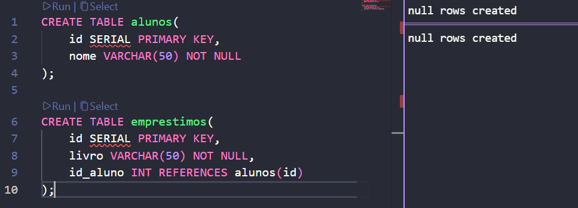
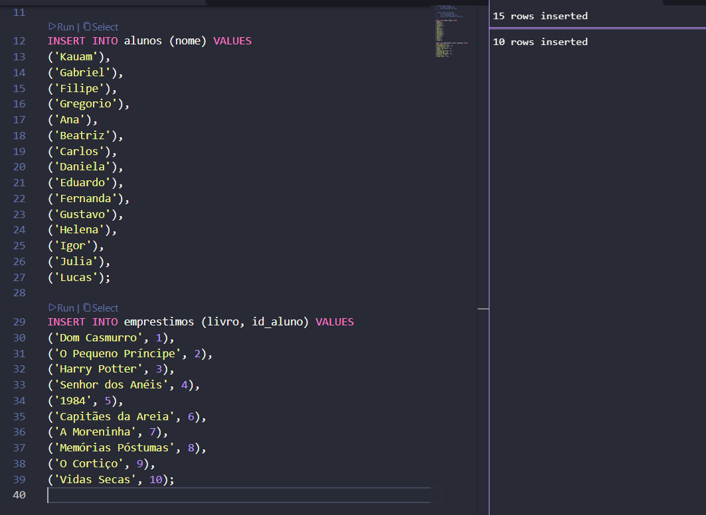
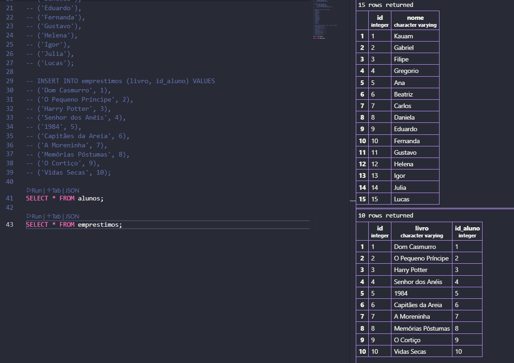
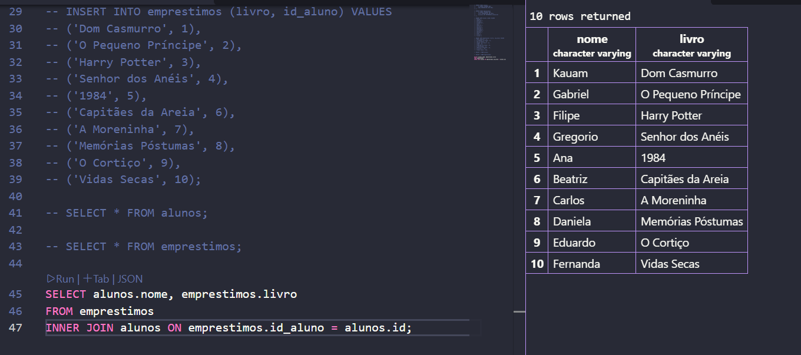
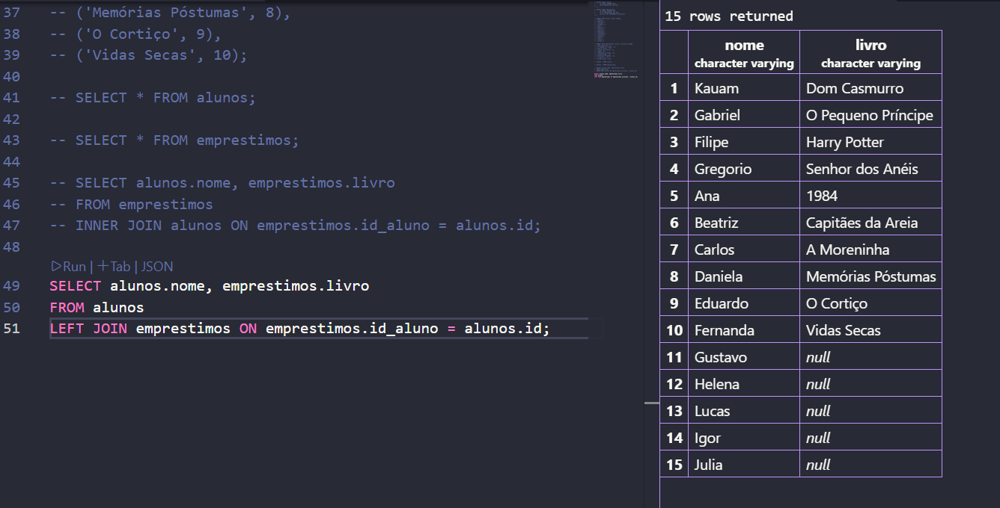

Atividade de SQL – Biblioteca da Escola 📚
Fiz essa atividade prática em SQL para entender melhor como funcionam os JOINs (INNER JOIN e LEFT JOIN), as consultas relacionais e a regra de integridade de dados no banco.

Criei a tabela

Coloquei todos os nomes

Para visualizar a tabela

Mostra todos os alunos cadastrados

Coloca os que fizeram emprestimo de livro primeiro

Tentativa de inserir um empréstimo para um aluno inexistente

O que aconteceu? O banco de dados barrou a inserção e deu um erro de violação de Chave Estrangeira (foreign key constraint).   Por quê? O campo id_aluno é uma chave estrangeira ligada à tabela de alunos. O banco não aceita registrar um empréstimo para alguém que não existe no cadastro, garantindo que os dados fiquem sempre corretos.   